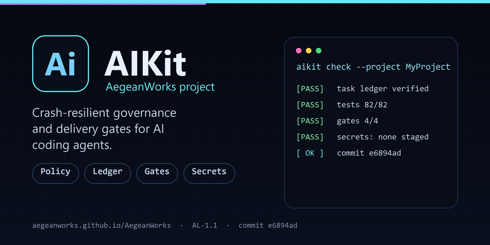

# 🤖 Universal AI Principles & Agent Operating System (Portable Kit)

<!-- aegean:media:start -->
<p align="center"></p>
<p align="center"><a href="LICENSE"></a> <a href="https://www.python.org/"></a></p>
*The banner is AI-generated and illustrative, not a literal feature map.*
<!-- aegean:media:end -->


> **AI governance, architecture principles & disruption (incl. power-cut) recovery for any software project**, extracted from production development, with documentation and regression-shielded workflows.

---

## ⚡ 30-Second Cold-Start Quick Reference

> **Orientation Contract**: verified commands and prerequisites below.

- **Runtime Prerequisites**: Python 3.10+ (standard library only; no pip dependencies) and `git`.
- **Canonical Regression Shield Gate**:
  ```bash
  python -m unittest discover tests
  ```
  *(100% test pass required before staging or committing).*

### 🛠️ Core Operational Command Matrix
| Operational Role| Canonical Command| Verification Gate|
|---|---|---|
| **Manage Projects**| `python aikit.py <cmd>`| `new`, `attach`, `list`, `status`, `check`, `fix` (ADR-119..124)|
| **Audit & Repair History**| `python aikit.py reforge <cmd>`| `start`, `audit`, `fix`, `run`, `stop`, `resume`, `settings`, `runs`, `status`, `report`; windows, Python AST (ADR-230, ADR-232, ADR-249)|
| **Route Ideas & Reviews**| `python aikit.py idea-catcher <cmd>`| `validate`, `render`, `status`, `ideas`, `tag`, `history`, `reviews`, `review-start/finish`, `revalidate`, `audit-claims`, `concepts`; shipped register tooling with a private register (ADR-246, ADR-252)|
| **Project Tags & Media**| `python aikit.py <cmd>`| `ui-id`, `topics --brief/--from-file`, `media init/capture/review/apply/audit`; AI-chosen tags, reviewed logos and commit-stamped screenshots (ADR-233..236)|
| **Run Regression Suite**| `python scripts/check_test_budgets.py`| Both tiers pass; per-test average <=20ms unit, <=500ms integration|
| **Run One Tier**| `python -m unittest tests.test_kit` / `python -m unittest tests.test_integration`| Isolates a failing tier|
| **Synchronize IDE Rules**| `python scripts/sync_principles.py`| <=1,750 est. tokens/target incl. a reserved 300-token Tier 1B|
| **Verify Rule Freshness**| `python scripts/sync_principles.py --check`| Read-only; exits 1 on rule drift, or when a principle changed since the last commit lacks an ADR naming its `--citing` set (PRINCIPLE-000 R3)|
| **Find Principles to Read**| `python scripts/sync_principles.py --involved <paths/commands/output>`| Same answer for every agent (PRINCIPLE-001 R3)|
| **Cross-Principle Check Set**| `python scripts/sync_principles.py --citing <PRINCIPLE-NNN>`| Principles a rule change must be checked against (PRINCIPLE-000 R3)|
| **Update AST & Knowledge**| `python scripts/update_knowledge_base.py`| Rewrites the codebase map, then runs every audit of `--check` below; exits 1 on a syntax error (Python 3.10 grammar) or any audit failure|
| **Codebase Digest**| `python scripts/update_knowledge_base.py --digest`| Read-only; one line per module in at most 100 lines, shared code first; a cut is stated|
| **Verify AST Map Freshness**| `python scripts/update_knowledge_base.py --check`| Read-only; exits 1 on a stale codebase map, README drift (PRINCIPLE-005), a `python <path>.py` naming a missing file, an ADR ID out of order, unfinished code (PRINCIPLE-007 R3) or a code-structure violation (PRINCIPLE-009 to PRINCIPLE-011)|
| **Classify Lifecycle Track**| `python scripts/disruption_recovery.py --track`| Prints Track A/B/C of current changes (PRINCIPLE-002 R3)|
| **Audit Disruption Recovery**| `python scripts/disruption_recovery.py --audit`| Clean status check; detects surviving uncommitted files|
| **Resume Interrupted Task**| `python scripts/disruption_recovery.py --resume`| Cold-start command: every `--audit` finding, then the interrupted task, its plan and resumption phase|
| **Record Task Checkpoint**| `python scripts/disruption_recovery.py --checkpoint <task_id> --phase-num <1-5> --desc <text>`| Appends a checkpoint (PRINCIPLE-002 R4); exits 2 when a task's first plan lacks `--why --benefits --risks --mitigation`, and warns when a task reaches Phase 3 with none (PRINCIPLE-007 R1, R6); exits 1 on credential-shaped text, or records `[REDACTED]` with `--redact` (PRINCIPLE-019 R3); `--handoff "next: ...; state: ...; failed: ...; open: ..."` records the packet `--resume` prints (PRINCIPLE-004 R2); `--agent <name>` and `--take-over` per PRINCIPLE-006 R7|
| **Complete Task Ledger**| `python scripts/disruption_recovery.py --complete <task_id>`| Marks the active task completed in `.agents/task_ledger.json`; exits 1, changing nothing, if `<task_id>` is not the active task|
| **Reset Active Task**| `python scripts/disruption_recovery.py --reset [reason]`| Abandons/clears in-progress task in ledger|
| **Purge Temp Buffers**| `python scripts/disruption_recovery.py --clean`| Deletes orphaned `*.tmp_*` buffers older than 60 s; younger ones may be a write in progress|
| **Secret Scan Gate**| `python scripts/check_secrets.py --staged\|--commits <range> [--workspace <project>]`| Exits 1 on a credential pattern in the staged diff or agent memory, or when any surface could not be scanned (PRINCIPLE-019)|
| **Verify the Commit Itself**| `python scripts/verify_commit.py`| Runs every gate against the commit alone in a throwaway worktree; exits 1 when the commit holds less than the tree it was tested in (PRINCIPLE-018 R7); warns on a file cut below half its size unless the message says `shrink-ok: <reason>`|
| **Reachability Shield**| `python scripts/check_reachability.py`| No unwired capability or phantom state key (PRINCIPLE-014 R7)|
| **Operational Dogfood Gate**| `python scripts/dogfood.py`| 5/5 tracks pass; zero host mutation (PRINCIPLE-015)|
| **Discover Any CLI**| `python scripts/<script>.py --help`| Prints usage and exits `0` in <250ms as a fresh process, writing nothing|
| **Sandbox the Ledger CLI**| `python scripts/disruption_recovery.py --workspace <dir> --audit`| Operates on `<dir>/.agents/`, never the repo ledger|

**Universal CLI contract (PRINCIPLE-011, PRINCIPLE-015).** Every CLI: `--help`/`-h` prints usage, writes nothing, exits `0`; exit `0` success, `1` operational failure, `2` misuse (an unknown flag is refused, never the default); failures print What → Why → Fix on stderr, never a traceback.

---

## 📦 What's Inside

```text
portable_agent_kit/
├── README.md                     <- This Integration & Setup Guide
├── LICENSE                       <- Aegean License 1.1 (AL-1.1)
├── COMMERCIAL.md                 <- Paid commercial terms (ACL-1.0)
├── licenses/                     <- Pinned Aegean license texts + PIN.json
├── aikit.py                      <- Project CLI
├── assets/                       <- Root brand assets
│   ├── logo.jpg
│   └── social-preview.png
├── reforge.py                    <- Aegean Reforge CLI entry point (and `aikit.py reforge`)
├── reforge/                      <- host-reviewed Git history auditor & safe repair engine
├── idea_catcher.py               <- Idea Catcher CLI entry point (and `aikit.py idea-catcher`)
├── idea_catcher/                 <- Target registry, idea ledger, review ledger and matrix renderer
│   ├── __init__.py
│   ├── __main__.py
│   ├── registry.py
│   ├── auto_register.py          <- Automatic idea registration from commit references
│   ├── claim_audit.py
│   ├── concept_map.py
│   ├── upstream_check.py
│   └── version.py
├── .gitignore                    <- Credential & local-state baseline (PRINCIPLE-019 R3)
├── AGENTS.md                     <- Generated Tier 1 capsules (AGENTS.md-convention hosts)
├── GUIDELINES.md                 <- Source of truth: every principle and rule (Tier 2)
├── GEMINI.md                     <- Google Gemini & Antigravity IDE rules
├── CLAUDE.md                     <- Claude Code configuration
├── .cursorrules                  <- Cursor IDE instructions
├── .windsurfrules                <- Codeium Windsurf IDE instructions
├── .clinerules                   <- Cline / Roo Code IDE instructions
├── .github/
│   ├── copilot-instructions.md   <- GitHub Copilot instructions
│   └── workflows/
│       └── ci.yml                <- CI gate (both tiers + freshness)
├── .claude/
│   ├── agents/                   <- Claude sub-agents (generated)
│   ├── settings.json             <- no agent may edit a task ledger
│   └── skills/
│       └── aikit/
│           ├── SKILL.md          <- Claude Code runbook (native skill)
│           ├── projects.md       <- Project command matrix (read on demand)
│           └── delegation.md     <- Sub-agent delegation (read on demand)
├── .agents/
│   ├── rules/
│   │   ├── principles.md         <- Antigravity / Agent IDE workspace rules
│   │   ├── domain.md.template    <- Template for project domain rules (Tier 1B)
│   │   ├── persistence.md.template <- Versioned state contract
│   │   └── readme_quickref.md.template <- Adopter README Quick Reference & tree (PRINCIPLE-005 R6)
│   ├── skills/
│   │   └── aikit/
│   │       ├── SKILL.md          <- Operational runbook index (source of the copies)
│   │       ├── projects.md       <- Project command matrix and Reforge protocol
│   │       └── delegation.md     <- Sub-agents, aikit delegate, headless OpenCode
│   ├── agents/
│   │   └── opencode_worker.md    <- OpenCode subagent spec for free models
│   └── task_ledger.json          <- Disruption ledger for power-loss resilience (WAL)
├── .opencode/
│   └── agents/                   <- OpenCode subagent profiles (architect, coder, ...)
├── opencode.jsonc                <- OpenCode provider, model & permission config
├── scripts/
│   ├── sync_principles.py        <- Generates 8 Tier 1 files from GUIDELINES.md
│   ├── sync_licenses.py          <- Pinned license/catalog sync and drift check
│   ├── disruption_recovery.py    <- Power-loss audit, atomic checkpointing & ledger CLI
│   ├── update_knowledge_base.py  <- Codebase AST symbol extractor & validator
│   ├── dogfood.py                <- Dogfood runner (sandbox jail + chaos tracks)
│   ├── check_reachability.py     <- Invariant reachability shield (anti-dead-capability)
│   ├── check_test_budgets.py     <- Test tier budget gate (per-test ceilings)
│   ├── project_registry.py       <- Project discovery, stack detection, memory
│   ├── project_license.py        <- License tiers and restrict
│   ├── marked_blocks.py          <- aegean:<name> blocks a generator owns in user files
│   ├── project_gates.py          <- A project's gates: detection, overrides
│   ├── check_project_hygiene.py  <- Source, asset & artifact hygiene
│   ├── ui_contract.py            <- Bounded UI-surface guard (opt-in .aikit/ui.json)
│   ├── ui_proof.py               <- UI proofs: inventory diff + style drift lint (pure)
│   ├── aikit_cli.py              <- `aikit.py` commands
│   ├── aikit_parser.py           <- `aikit.py` grammar, alone for --help
│   ├── subagent_delegate.py      <- Bounded OpenCode sub-agent runs
│   ├── project_publish.py        <- Uploads a project to its own GitHub repo
│   ├── project_ui.py             <- Durable has_ui/ui_kind identifier (ADR-233)
│   ├── project_topics.py         <- AI topic brief and validator, max 20 (ADR-236)
│   ├── project_media.py          <- Reviewed logo/social/screenshot pipeline (ADR-235)
│   ├── project_brand.py          <- Per-project motif, palette and social composition (ADR-238)
│   ├── project_artwork.py        <- Image-model hero art plus exact text overlay (ADR-239)
│   ├── brand_catalog.json        <- Authored unique project identities
│   ├── check_secrets.py          <- Secret/sensitive data scanner
│   └── verify_commit.py          <- Verifies a commit alone in a throwaway worktree
├── tests/
│   ├── test_kit.py               <- Unit tier (<=20ms per test)
│   ├── test_auto_register.py     <- Unit tier: idea registration from commits
│   └── test_integration.py       <- Integration tier: concurrency, CLI contracts
└── knowledge/
    ├── INDEX.md                  <- Knowledge base table of contents
    ├── architecture.md           <- System architecture and component boundaries
    ├── services.md               <- Core services and API contracts
    ├── data_models.md            <- Data structures, schemas, and persistence models
    ├── state_and_ui.md           <- Presentation layer, UI state, and event loops
    ├── decisions.md              <- Architectural Decision Records (ADRs)
    ├── codebase_map.md           <- Auto-generated AST catalog of classes and functions
    ├── model_benchmarks.md       <- Subagent model benchmarks & selection tree
    ├── host_clients.md           <- Host client portability & parity
    ├── repo_backlog.md           <- Repos left for later
    └── principles_audit_ledger.md  <- Snapshot audit at ADR-107 (not kept current)
```

---

## 🚀 Start a Project

Open this folder in any AI host and describe what to build. Each project gets its own folder under `projects/` (ignored by AIKit's git) and its own repository; AIKit's gates, map and ledger never read it. `new` also detects the UI kind, adds license topics and creates logo/social candidates that must be reviewed before `publish` (ADR-243, ADR-245).

```bash
python aikit.py new my-app --description "<10-350 chars>" --topic web  # new repo, .aikit/, AL-1.1 LICENSE, AIKit badge
python aikit.py attach ../existing  # register an existing folder; adds .aikit/, ignore rules, badge
python aikit.py list                # every project, its stack and test command
python aikit.py status my-app       # task, changes, decision; --exit-code fails when dirty, --json for CI
python aikit.py check my-app        # tests, checks, hygiene, guidelines, secrets; --push pushes (exit 1 if blocked)
python aikit.py check my-app --strict  # delivery gate: clean tree, map, no conflicts, no open UI task
python aikit.py ui init my-app        # React/Vite pilot: write a conservative .aikit/ui.json
python aikit.py ui init my-app --fast "npm run test" --paths "src/**"  # other stacks
python aikit.py ui begin my-app --surface menu  # bound edits to one declared UI surface
python aikit.py ui verify my-app       # scope, budget, fast + snapshot proofs, style drift
python aikit.py ui allow my-app "Btn*" --reason "<why>"  # intended inventory removal
python aikit.py ui finish my-app --reviewed  # close after review; evidence in .aikit/ui_history.json
python aikit.py fix my-app          # restore memory/README, adopt UI, refresh map, then check
python aikit.py guideline my-app "money is integer cents" --source user  # project rule
python aikit.py publish my-app [--owner ORG] [--license auto]  # repo, description, recorded AI topics
python aikit.py license my-app [--suggest|--set game|--restrict]  # AL-1.1, AGL-1.1 (DRM-free games) or ASL-1.1 (science)
```
A project's memory is `.aikit/`; ledger commands take `--workspace projects/<name>`. `publish` needs a 10-350 character README description; `license` picks AL-1.1, AGL-1.1 or ASL-1.1. Before a commit `check` wants `checklists: passed`; deliberate hygiene findings need `hygiene: allow <reason>`. `ui` (opt-in `.aikit/ui.json`) bounds surfaces and proofs; `finish` needs `--reviewed` (ADR-160..166). `fix` adopts a detected UI project when it has a test command: it writes a conservative `.aikit/ui.json`, marks `ui_required`, and never invents a proof when no test command exists. A game project can declare a headless mechanics contract in `.aikit/project.json` (`mechanics.core` paths and `mechanics.test`); `check` validates it and runs it as a gate, so the same mechanics are testable by an agent and callable by the UI. `check`/`fix`/`publish` run a project's commands unsandboxed: attach trusted repositories.

## 🔁 Aegean Reforge: Host Review & Safe Repair

Reforge audits history in widening windows and repairs only what it can prove. It lives in
`reforge/` and `reforge.py`: `aikit.py reforge` uses the project registry, `python -m reforge`
the bare engine. The standalone repository is archived (ADR-248).

```bash
python aikit.py reforge start my-app --start 3 --step 3 --stop 15  # new independent run
python aikit.py reforge audit my-app       # write the review packet for the next window
python aikit.py reforge fix my-app --findings answer.json  # validate, repair, verify
python aikit.py reforge run my-app --findings answer.json --push  # audit, repair, verify, push
python aikit.py reforge run my-app --rules # deterministic rule pass, no host review
```

Window N is `start + step*(N-1)`, capped by `stop`: stage 1 reads the first `start` commits and each
later stage adds `step`. A stage inspects only the lines its own commits add, attributes a finding to
the commit that introduced it, and cites `commit:path:line`. Its Python rules cover exceptions,
shell/exec, deserialisation, mutable defaults, timeouts, secrets and control flow; five are repaired
mechanically (`bare-except`, `mutable-default`, `shell-true`, `verify-false`, `unsafe-yaml-load`),
each earning a regression test. Every changed text file is reviewed, not only Python: JSON and TOML
must parse, a Markdown code fence must close, and a committed conflict marker is a defect; only a
binary file is reported as not analysed, and the stage prints how many files it reviewed. A
deliberate finding marked `hygiene: allow <reason>` on its line or the line above is honoured
rather than reported, the same convention AIKit's own hygiene scan uses. The rule pass is opt-in
(`--rules`) because the host review covers the same ground without inventing a second linter.

`audit` and `run` write a review packet under `.aikit/reforge.reviews/` (ADR-263, ADR-272). The
packet lists every new commit oldest to newest with that commit's own hunks, so a later commit
cannot hide an earlier minute change; a file can appear once per commit. Only files a new commit
touched appear, and files that only an earlier stage changed are not repeated. Binary files are
named at the end and the JSON answer schema follows. Credential-shaped spans are redacted with the
project's secret scanner before the packet is written. Reforge makes no
model call and starts no subagent: the agent or person driving the session reads the packet and
returns a findings file. Each finding names a path the stage changed, a line that exists, a severity,
`kind` `defect` or `improvement`, and optional `fix.old`/`fix.new`. It may name the `commit` and
`hunk` it reviewed (each packet hunk has a stable id); an optional `reviewed_hunks` list records
which hunks were read, so a partial pass is visible. Reforge accepts a fix only when
the quoted text occurs exactly once, overlaps a line the stage added, and leaves a Python file
parsable; everything else is reported as rejected. Run `fix --findings answer.json` to apply the
accepted fixes; `run --rules` is the deterministic-only pass. A red test, gate or diff review
restores the exact bytes. A repair may run beside unrelated uncommitted work: its paths are
snapshotted and never staged, and a commit is refused only when a finding's own target file already
held work Reforge did not make (pass `--allow-dirty` to accept that risk deliberately).

Runs are independent (`settings`, `stop`, `resume`, `runs`, `report`) and state is crash-safe. Each
project has its own lock, state and history, so several projects audit at the same time while a
second operation on one is refused; a target is resolved first, so two spellings of one checkout
share one lock. In a project, `--commit`/`--push` stage only reviewed paths plus `.aikit/reforge.json`
and never force. AIKit's own `.aikit/` folder is a git-ignored tool-state directory, so auditing
AIKit itself records state locally and commits only the reviewed source paths.

Where the repository has an AIKit ledger, every run also appends checkpoints under the
`reforge:<run-id>` task, so `disruption_recovery.py --resume` shows an open audit and a
stopped run in the paused list; `active_task` is never touched, the ledger's own `.bak` and
`.lock` count as Reforge's bookkeeping, and a plain checkout without a ledger simply audits
without one (ADR-250).

## 🧭 Idea Catcher: Routed Idea Register

Idea Catcher is integrated into AIKit: its only source lives in `idea_catcher/` and
`idea_catcher.py`. Its register is private local data under `.idea-catcher/` at the AIKit root;
that path is git-ignored, so the ideas it has collected never enter a commit or the public
repository (ADR-252). `IDEA_CATCHER_ROOT` points the tool at a different register.

```bash
python aikit.py idea-catcher status             # full register counts per target
python aikit.py idea-catcher validate           # targets, ideas, dossiers and matrix
python aikit.py idea-catcher render --check     # fail when MATRIX.md is stale
python aikit.py idea-catcher sync --repo . --project <target>  # register IDEA-NNN commit references
python aikit.py idea-catcher reviews --stale
```

A commit message that names `IDEA-NNN` is the automatic implementation signal. `aikit check
--push` and `aikit publish` scan the delivered project's newest commits and mark matching ideas
`Integrated` with the commit as evidence; the generated `MATRIX.md` is refreshed in the same
step. `idea-catcher sync` does the same on demand, and `--dry-run` previews it. The idea must
belong to the project's target; already closed ideas are untouched.

A review leases its repository and reserves idea ids, so parallel analyses cannot collide.
Dossiers name a `Source` from `IDEA-632` onward; tags, target and status changes append to each
idea's history. `ideas --target <id>` hides `Rejected` rows and rows tagged `duplicate`; pass
`--include-rejected` or `--include-duplicates` for the full audit view. The flags are alternatives:
either one also shows a row that belongs to both categories. `status` always reports the full
register, while `ideas` is the filtered working list. `MATRIX.md` keeps both, and a reviewer may
reject a harmful idea directly with a recorded reason and author (ADR-264, ADR-267).

`ui-id` stores `has_ui`, `ui_kind` and `ui_evidence`. `topics --brief` gives an AI the evidence;
`--from-file` records its tags and `--apply` publishes them, capped at 20. `media init --art` uses
the online image model with `POLLINATIONS_API_KEY`; `review/apply/audit` require a named reviewer and
shots.

## 📥 Alternative: Copy AIKit Into an Existing Project

The primary path is above. To govern a repository in place, copy `GUIDELINES.md`, `scripts/`,
`knowledge/` and `.agents/`, run the sync scripts, and keep project rules in `domain.md`. Do not
copy `tests/`, `.github/` or the ledger.

---

## 🏛️ The 20 Core Principles (Lifecycle-Ordered)

The principles are strictly organized across **5 chronological execution phases**:

<!-- principles:begin (generated from GUIDELINES.md by scripts/sync_principles.py; do not edit) -->
### 🏛️ Phase 1: Meta-Governance & Attentional Grounding
| Principle | Title | Capsule |
|---|---|---|
| **PRINCIPLE-000** | Meta-Principle Integrity & Mutual Alignment | Every rule binds; conflicts follow R6 order; rule edits re-check every citing principle; gaming a gate is a violation; quality doubts go to the user. |
| **PRINCIPLE-001** | Progressive Rule Disclosure & Governance Frugality | Pre-Flight checklist before the first Track C edit; Post-Flight checklist before any Track B or C commit; report only failed items (R8). |
| **PRINCIPLE-002** | Lifecycle-Aligned Instruction Ordering & Attentional Priming | Track via `disruption_recovery.py --track` (A none, B docs/comments but not rule files, C rest); urgency alone never skips P018 gates (R5). |
| **PRINCIPLE-003** | Empirical Grounding & Anti-Hallucination Invariant | Read-before-write slice freshness; `git grep -w -e` call-site check; deps only if declared; platform parity; ask on intent ambiguity; strict AST syntax gate. |
| **PRINCIPLE-004** | Attentional Drift Prevention & Compaction Resilience | Plan = latest `[1/` Phase 2 `--desc` in `task_ledger.json`; cold start `--resume`; never re-ask recorded answers; ADR before commit; reads/output <=100 lines. |

### 🧭 Phase 2: Pre-Flight Orientation & Planning
| Principle | Title | Capsule |
|---|---|---|
| **PRINCIPLE-005** | AI Cold-Start Readiness & Living Documentation | README <=30k chars: prerequisites, test command, tree; user-visible changes update it same commit; `update_knowledge_base.py --check` gates it. |
| **PRINCIPLE-006** | Incremental Progress Checkpointing & Disruption Recovery | Commit `[milestone N/M]` once Phase 4 passes under PRINCIPLE-018 R1; failing work uncommitted via `--checkpoint`; `--complete`/`--reset` before switching tasks; `--clean` stale `.tmp_*`; ledger writes name `--agent`; another agent's task needs `--take-over`. |
| **PRINCIPLE-007** | Pre-flight Impact & Quality Checklist | Track C first plan checkpoint carries --why --benefits --risks (contract, dependency, concurrency, state) --mitigation; no TODO or stub; no change outside the plan. |
| **PRINCIPLE-008** | Hierarchical Problem & Task Decomposition | Plan of M<=6 milestones (more: split into tasks), built bottom-up, each passing Phase 4 alone; re-plan = new `[1/M']` checkpoint; sub-agents never write the ledger. |

### 🏗️ Phase 3: Architecture & Lean Implementation
| Principle | Title | Capsule |
|---|---|---|
| **PRINCIPLE-009** | Modularity & Pluggable Architecture | Every module: no junk-drawer name, roles of 1-5 methods, no import cycle (gated). At a pluggable boundary: 4 layers, registry lookup, constructor DI with default, frozen DTOs. |
| **PRINCIPLE-010** | Performance & Resource Optimization | Stream uncontrolled input; threads only for steps >=200ms; timeout= on subprocess, with on open(); one fsync per file; `--help` <250ms; unit <=20ms, integ <=500ms/test. |
| **PRINCIPLE-011** | Zero-Friction Onboarding & Instant Usability | Only declared deps; creates its dirs; prompts only with `--interactive`; no `os.environ[...]` reads; exit 0/1/2; errors give `Why:`/`Fix:`; demo <10s; other software: its `aikit.py` project is the workspace (R8). |
| **PRINCIPLE-012** | Token Frugality & Lean Code Architecture | LLM code: <=16k-char payloads, static prefix first, schema-checked replies, 429 backoff, step caps; agent: diff -U3, search <=50 hits, relative paths. |

### 🛡️ Phase 4: Operational Verification & Resilience
| Principle | Title | Capsule |
|---|---|---|
| **PRINCIPLE-013** | Crash Resilience, State Atomicity & Power-Loss Recovery | State files: >=10MB free, temp + fsync + os.replace (5 tries) + dir fsync, .bak, advisory locking 3s/30s stale, corrupt -> quarantine/.bak/migrate. Generated: temp + fsync + replace. |
| **PRINCIPLE-014** | Automated Test Verification & Continuous Test Coverage | 100% test pass gate; behaviour change = failing-first test; weakening a test needs user approval + ADR naming it; unit <=20ms/test, no spawns/sleeps; integ <=500ms/test; tempdir + addCleanup; `scripts/check_reachability.py`. |
| **PRINCIPLE-015** | Universal Operational Dogfooding & Chaos Verification | Domain-specific interactive dogfooding via `scripts/dogfood.py` as a commit gate; golden path + chaos perturbation; non-interactive stdin parity; portable RAII process tree teardown; ephemeral safety jail; terse reporting (<=15 lines). |

### 🚀 Phase 5: Living Synchronization & Delivery
| Principle | Title | Capsule |
|---|---|---|
| **PRINCIPLE-016** | AI Knowledge Base & Continuous Synchronization | Canonical `knowledge/` sync; atomic code-and-doc pairing; monotonic append-only ADR register; strict AST syntax validation; link integrity shield; `scripts/update_knowledge_base.py`. |
| **PRINCIPLE-017** | Living Principles System & Automated Synchronization | Rule sync (`scripts/sync_principles.py`); context budget check; schema compliance; freshness test gate; Tier 1B domain rules (<=1,200 chars). |
| **PRINCIPLE-018** | Automatic Git Workflow | Conventional commits (`--validate-commit`) + adaptive push, never forced, only if authorized (R1); explicit staging (no `git add .`); pre-commit triad (tests/gates/diff); commit verified alone pre-push (R7); non-destructive recoil. |
| **PRINCIPLE-019** | Secret & Sensitive Data Hygiene | Zero credentials in tracked files, logs or ledgers; secrets via env/secret store; `.gitignore` credential baseline; `scripts/check_secrets.py` scans staged diffs + ledger; redacted diagnostics; rotate, never revert. |
<!-- principles:end -->
---

## ⚡ Disruption Recovery & Power-Loss Protection

If electricity cuts out, battery dies, or the computer crashes mid-task:
1. **Pre-flight Audit**: On a cold start, run this one command first (PRINCIPLE-004 R2):
   ```bash
   python scripts/disruption_recovery.py --resume
   ```
   It prints `--audit` findings, the active task, plan and resumption phase; with none it confirms a clean working tree.
2. **Everything else** (`--audit`, `--checkpoint`, `--complete`, `--reset`, `--clean`) is in the command matrix above.
3. **Atomic File Safety**: state files use temp write, fsync and atomic rename (PRINCIPLE-013); corrupt ledgers auto-recover from `.bak`.

---

## 🛠️ Adding New Principles to Your Project

1. Add `### PRINCIPLE-0XX: [Title]` (the next free ID) to `GUIDELINES.md` only, with `Problem`, `Concept`, `Invariant` and numbered `Rules`, under the right lifecycle heading.
2. Raise `MIN_PRINCIPLES` in `scripts/sync_principles.py` and `EXPECTED_PRINCIPLE_COUNT` in `tests/test_kit.py`; add the ID to this README and both checklists.
3. Run `python scripts/sync_principles.py`. On `[TOKEN EXCEEDED]` or `[TIER 1B HEADROOM]`, pay for the new capsule by condensing existing capsule narrative (PRINCIPLE-001 R9).
4. All 8 generated Tier 1 files then carry the new capsule.
